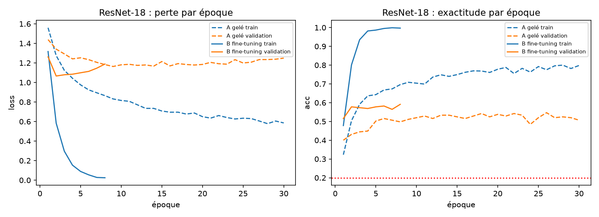
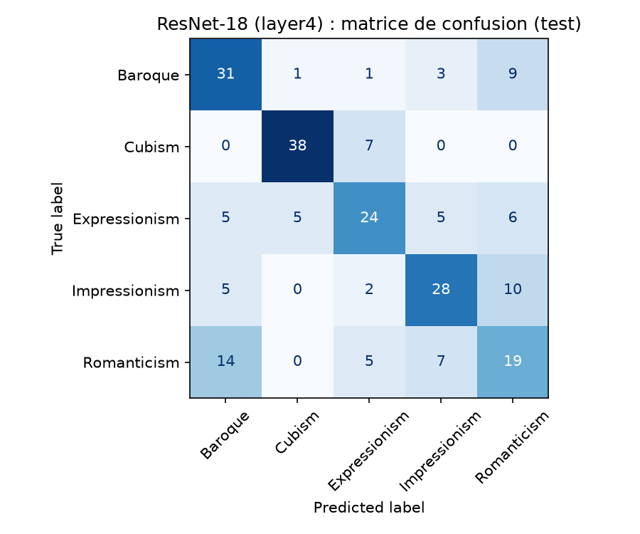

# museum-guide

Project for "Neural Networks & Deep Learning Foundations" (Albert School):
a museum guide that recognises the style of a painting from a photo.

Question asked by the museum director: is a neural network worth it on kiosks with modest CPUs,
or is a simpler classical model enough?

## Data (not versioned: WikiArt licence unknown)

The images are not in this repository. To recreate them:

```
pip install "datasets>=3.0" pillow
python make_wikiart_subset.py --label style --classes Impressionism Baroque Cubism Expressionism Romanticism --per-class 300 --size 128 --out data/wikiart_style5
```

5 styles x 300 images, 128x128 pixels. The dataset revision is pinned in the script.

## Step 1 results: baselines (validation, 225 images)

| Model | Validation accuracy |
|---|---|
| Chance (majority class) | 20.0% |
| Logistic regression (C=0.0001) | 34.2% |
| MLP, last epoch | 29.3% |
| MLP, best epoch | 34.2% |

Scripts: `m1_dense.py` (MLP), `m1_logreg.py` (logistic regression). 70/15/15 split with seed 42,
normalisation computed on the train set only. The test set (225 images) is not used yet.
With 225 images, the uncertainty on an accuracy is about ±3 points.


Most confused styles: Baroque <-> Romanticism (16 + 9 errors), Cubism <-> Expressionism (13 + 9).

## Failure diagnosis

Script: `m2_diagnosis.py`.

**Symptom.** The MLP reaches 99.0% accuracy on the train set but only 29.3% on validation
(a gap of 69.6 points). The validation loss is lowest at epoch 3 (1.636) and then rises to 3.114,
while the train loss falls to 0.06.


**Code check.** The initial loss is 1.625 (expected for 5 random classes: ln 5 = 1.609).
On a single batch of 32 images, the loss drops to 0.0001 after 200 steps. The code therefore learns correctly: this is not a bug.

**Cause.** Overfitting: 393,989 weights for 1,050 training images. The network memorises the images
instead of learning style patterns. An MLP on pixels does not see textures or local shapes.

**Remedies tested** (30 epochs, same data, chosen on validation):

| Remedy | Final train | Final val | Lowest val loss (epoch) |
|---|---|---|---|
| None | 99.0% | 29.3% | 1.636 (3) |
| Dropout 0.5 | 92.6% | 34.2% | 1.600 (3) |
| Weight decay 0.1 | 99.0% | 30.7% | 1.636 (3) |
| Small network (16 neurons) | 92.1% | 34.7% | 1.557 (4) |
| Image flipping | 91.7% | 29.3% | 1.647 (3) |
| Dropout + weight decay + flipping | 75.9% | 33.8% | 1.560 (15) |

**Numerical evidence / conclusion.** The remedies reduce the train/validation gap but validation stays
around 30-35%, within the margin of uncertainty (±3 points). The problem comes from the type of model, which motivates
a CNN (step 3).


## Step 3: pretrained ResNet-18 (validation, 225 images)

Script: `m3_resnet.py`. ResNet-18 with ImageNet weights, 128x128 images, last layer replaced by an `nn.Linear` with 5 outputs.
Training loop written by hand. The test set is still not used.

| Variant | Trained parameters | Val (best epoch) | Final val | Final train | Duration |
|---|---|---|---|---|---|
| A: frozen backbone (30 epochs) | 2,565 | 51.1% (epoch 9) | 50.7% | 79.8% | 401 s |
| B: full fine-tuning (8 epochs, image flipping) | 11,179,077 | 57.8% (epoch 2) | 59.1% | 99.7% | 307 s |

In this first version, variant B was ahead (1.066 vs 1.163); variant C below then overtook it.
Cost of variant B: 11,179,077 parameters (44.7 MB), 24.6 ms per image on CPU (4 threads, one image at a time).
For comparison, the MLP and logistic regression plateau around 34% on validation.



### Variant C: unfreeze only layer4 (`m3c_layer4.py`)

layer4 + last layer trained (8,396,293 parameters), learning rate 1e-4, 6 epochs, frozen layers in eval mode, image flipping.

| Variant | Val loss | Val accuracy (best epoch) | Training duration |
|---|---|---|---|
| A: frozen backbone (BatchNorm still updated) | 1.163 | 51.1% | 401 s |
| B: everything unfrozen | 1.066 | 57.8% | 307 s |
| **C: layer4 unfrozen** | **1.018** | **58.7%** (epoch 4) | **78 s** |
| Strict A: linear classifier on frozen features | 1.041 | 56.9% | a few seconds |

C is selected on the lowest validation loss. The "strict A" (features computed once, backbone in eval mode,
a single `nn.Linear` layer) does clearly better than my initial A: in A, `model.train()` let the BatchNorm statistics
of the backbone change, which degraded it. A linear classifier on pretrained features is therefore
almost as good as fine-tuning (a gap of 1.8 points, within the ±6 point margin).

## Step 4: final measurement on the test set (once only) and recommendation

Script: `m4_final.py` (dry run on validation, then `python m4_final.py test` once only; the script refuses to run again).
Raw results: `results/m4_final.json`, `results/m4_final_table.csv`.

| Model | **Test** accuracy (±95%) | Val | Parameters | Size | ms/image (1 thread) | ms/image (4 threads) | Training |
|---|---|---|---|---|---|---|---|
| Chance | 20.0% | | | | | | |
| Logistic regression (32x32 pixels) | 28.9% (±5.9) | 34.2% | 15,365 | 0.06 MB | 0.12 | - | 0.5 s |
| MLP 16 neurons (32x32 pixels) | 30.2% (±6.0) | 34.2% | 49,253 | 0.20 MB | 0.05 | 0.04 | 0.8 s |
| **ResNet-18, layer4 unfrozen (128x128)** | **62.2% (±6.3)** | 58.7% | 11,179,077 | 44.72 MB | 18.94 | 11.45 | 78 s |

Test: 225 images never used before. ±95% = binomial confidence interval. Times measured on my laptop
(CPU, one image at a time, model only: reading and resizing the photo excluded). ResNet training: 78 s, duration measured in `m3c_layer4.py`.



Accuracy per style on the test set: Cubism 84%, Baroque 69%, Impressionism 62%, Expressionism 53%, Romanticism 42%.
Main confusions: Romanticism mistaken for Baroque (14) or Impressionism (7), Impressionism mistaken for Romanticism (10).

### Recommendation to the director

**Yes, a neural network is worth it, but a pretrained one, not one trained from scratch.**

- **Accuracy.** The ResNet-18 recognises the right style in 62% of cases versus 29-30% for the simple models on pixels
  (chance: 20%). The gap of more than 30 points is well above the uncertainty (about ±6 points).
- **Kiosks with modest CPUs.** The ResNet-18 takes 19 ms per image on a single core: imperceptible for a visitor.
  It weighs 45 MB, which fits easily on a phone or a kiosk. The "modest CPU" criterion is therefore not a blocker.
- **Small team, limited budget.** No GPU: training took 78 s on a laptop. We reuse a public model
  (ResNet-18) and only add a small part to train. No service to maintain: the model runs on the device.
- **Simplest option to maintain.** The frozen variant "strict A" is a linear classifier on pretrained features:
  the ResNet is used as is to describe the image, then a simple linear layer gives the style. On validation it
  reaches 56.9% versus 58.7% for the selected variant (difference not significant; it was not measured on the test set).
  It is the variant to try first if the team wants almost instant training and little risk of overfitting.
- **Before going live.** About 4 answers out of 10 are still wrong: offer the two most likely styles or display a
  confidence level, and test on real visitor photos.

A classical model is not accurate enough here, but only the one tested (raw pixels). Hand-crafted classical descriptors
(colour histograms, textures) were not tried.

### Limitations

- **Little data**: 1,500 images (300 per style), 225 test images. The uncertainty is about ±6 points.
  Differences of a few points between A, B and C are not significant.
- **Only 5 styles** out of the 27 in the dataset: a real museum would have more styles, closer to each other, and accuracy would drop.
- **A single seed** (42) and a single split: run-to-run variability is not measured.
- **Possible artist bias**: the same painter appears in several images (limited to 50 per artist), and 60% of the images come
  from "unknown artist". The model may recognise a painter or a collection rather than a style. No artist-disjoint split was tested.
- **WikiArt images, not real photos**: reflections, angles and lighting of a phone are not represented. Images reduced to 128x128.
- **Times measured on my laptop**, not on the real kiosk; they vary from one measurement to another
  (the same ResNet measurement gave 24.6 ms in step 3, 11.5 ms here with 4 threads).
- **Limited classical baseline**: logistic regression on pixels only.
