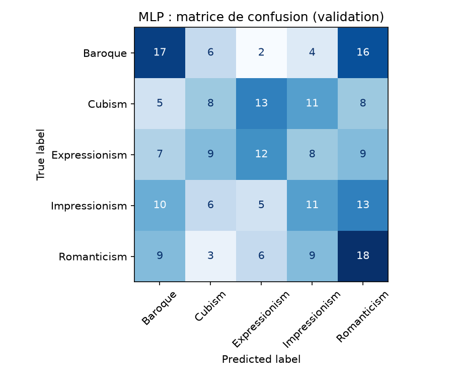
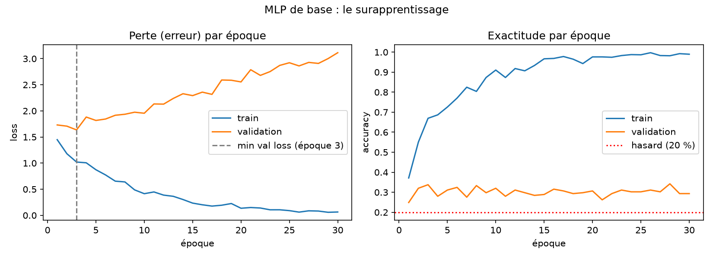
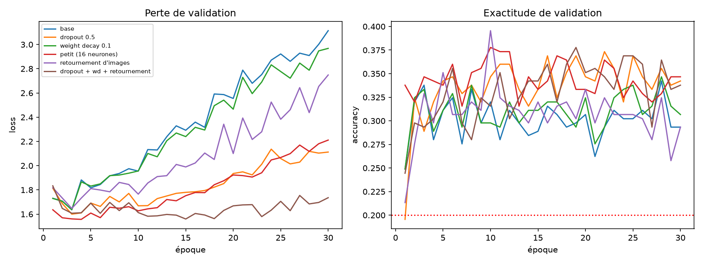

# museum-guide

Projet "Neural Networks & Deep Learning Foundations" (Albert School) :
un guide de musée qui reconnaît le style d'une peinture à partir d'une photo.

Question posée par le directeur : un réseau de neurones vaut-il le coup sur des bornes
à CPU modeste, ou un modèle classique plus simple suffit-il ?

## Données (non versionnées : licence WikiArt inconnue)

Les images ne sont pas dans ce dépôt. Pour les recréer :

```
pip install "datasets>=3.0" pillow
python make_wikiart_subset.py --label style --classes Impressionism Baroque Cubism Expressionism Romanticism --per-class 300 --size 128 --out data/wikiart_style5
```

5 styles x 300 images, 128x128 pixels. Révision du dataset épinglée dans le script.

## Résultats de l'étape 1 : baselines (validation, 225 images)

| Modèle | Exactitude validation |
|---|---|
| Hasard (classe majoritaire) | 20.0 % |
| Régression logistique (C=0.0001) | 34.2 % |
| MLP, dernière époque | 29.3 % |
| MLP, meilleure époque | 34.2 % |

Scripts : `m1_dense.py` (MLP), `m1_logreg.py` (régression logistique). Split 70/15/15 avec seed 42,
normalisation calculée sur le train seulement. Le test (225 images) n'est pas encore utilisé.
Avec 225 images, l'incertitude sur une exactitude est d'environ ±3 points.



Styles les plus confondus : Baroque <-> Romanticism (16 + 9 erreurs), Cubism <-> Expressionism (13 + 9).

## Failure diagnosis

Script : `m2_diagnosis.py`.

**Symptôme.** Le MLP atteint 99.0 % d'exactitude sur le train mais seulement 29.3 % sur la validation
(écart de 69.6 points). La perte de validation est minimale à l'époque 3 (1.636) puis remonte jusqu'à 3.114,
alors que la perte du train tombe à 0.06.



**Vérification du code.** La perte initiale est 1.625 (attendu pour 5 classes au hasard : ln 5 = 1.609).
Sur un seul lot de 32 images, la perte tombe à 0.0001 après 200 pas. Le code apprend donc correctement : ce n'est pas un bug.

**Cause.** Surapprentissage : 393 989 poids pour 1 050 images d'entraînement. Le réseau mémorise les images
au lieu d'apprendre des motifs de style. Un MLP sur pixels ne voit pas les textures ni les formes locales.

**Remèdes testés** (30 époques, mêmes données, choix sur la validation) :

| Remède | Train final | Val finale | Plus petite perte val (époque) |
|---|---|---|---|
| Aucun | 99.0 % | 29.3 % | 1.636 (3) |
| Dropout 0.5 | 92.6 % | 34.2 % | 1.600 (3) |
| Weight decay 0.1 | 99.0 % | 30.7 % | 1.636 (3) |
| Petit réseau (16 neurones) | 92.1 % | 34.7 % | 1.557 (4) |
| Retournement d'images | 91.7 % | 29.3 % | 1.647 (3) |
| Dropout + weight decay + retournement | 75.9 % | 33.8 % | 1.560 (15) |

**Preuve chiffrée / conclusion.** Les remèdes réduisent l'écart train/validation mais la validation reste
autour de 30-35 %, dans la marge d'incertitude (±3 points). Le problème vient du type de modèle, ce qui motive
un CNN (étape 3).


